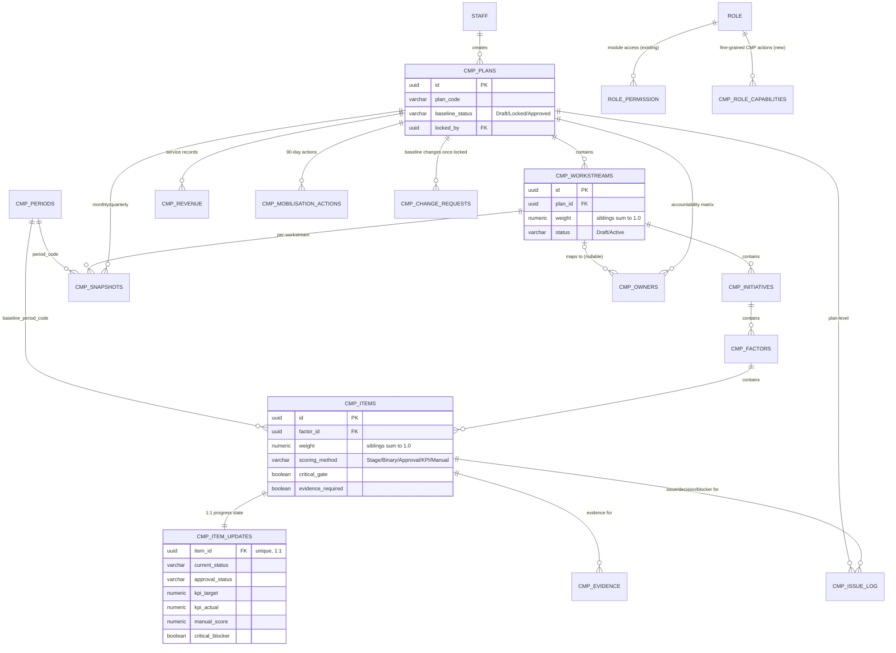

# 10 — CMP Solution Design (Phase 1)

**Status:** Draft. Written 2026-08-11 against the "v1.2/v1.3 Execution Ready" tracker
(byte-identical to the 2026-07-31 version reviewed earlier — see
`documents/` MD5 check in the 2026-08-11 session). Schema (migrations
033-037) and `lib/cmp/calculations.ts` are already built and verified; this
document covers the remaining Phase 1 deliverables per
`Claude_CSIDOP_CMP_Integration_Master_Prompt_v1.3_Execution_Ready.txt`:
ERD, role/capability matrix, API design, screen map.

**Supersedes:** `05_module_architecture.md` and `07_security_permission_model.md`
in this folder, which were written against the first (2026-07-15/07-17)
fixed-entity schema — dropped 2026-07-31. Kept for historical reference
only; do not build against them.

---

## 1. ERD

Overall weight, score, RAG, variance and every rollup are **computed at
read time** by `lib/cmp/calculations.ts` — never stored, per the "AI must
not invent scores; deterministic backend calculates official results"
rule. Nothing in this ERD changes that.

---

## 2. Role & capability-flag matrix

The master prompt names 12 roles (CMP Administrator, HOD/Plan Owner,
Workstream Owner, Initiative Owner, Item Owner, Evidence Reviewer, Finance
Reviewer, Healthcare Business Lead, Management Sponsor, Decision Owner,
Management Viewer, System Administrator) that don't exist in CSIDOP's real
`Role` type (`HOD | SolutionManager | TeamLead | TeamMember | BIMModeler |
BIMTeamLead`). Per the 2026-07-31 decision, these are mapped onto existing
roles via two layers, both extending mechanisms that already exist rather
than touching `STAFF`/`ROLE`:

- **Module-level access** — add `'cmp'` as a new `ModuleCode` value in the
  existing `ROLE_PERMISSION` table (migration 023), same `none/view/full`
  pattern already used for `work_orders`, `capacity`, etc. Admin-configurable
  via the existing Admin > Permissions screen, no new UI needed for this
  layer.
- **Fine-grained action capabilities** — a new `cmp_role_capabilities`
  table (`RoleId` + `capability_code` boolean, same shape as
  `ROLE_PERMISSION`), for actions that a blunt view/full toggle can't
  express (e.g. a Workstream Owner and an Evidence Reviewer both need
  `full` on the `cmp` module, but only one should be able to verify
  evidence).

| Tracker role | CSIDOP role(s) | `cmp` module access | Capability flags (new table) | Scope |
|---|---|---|---|---|
| System Administrator | SolutionManager, HOD | full | `manage_role_capabilities`, `manage_periods` | Department |
| CMP Administrator | SolutionManager | full | `manage_hierarchy`, `manage_weights` | Department |
| HOD / Plan Owner | HOD | full | `approve_baseline`, `lock_plan`, `override_critical_gate` | Department |
| Workstream Owner | TeamLead, BIMTeamLead | full | `manage_workstream_items`, `update_progress` | Pod (own workstream, via `cmp_owners.accountable_owner` mapped to a `staff.id`) |
| Initiative Owner | TeamLead, SolutionManager | full | `update_progress` | Pod (own initiative) |
| Item Owner | TeamMember, BIMModeler | view+own-item-edit | `update_item_progress` | Self (own assigned items only) |
| Evidence Reviewer | TeamLead, SolutionManager | full | `verify_evidence` | Pod/Department |
| Finance Reviewer | SolutionManager | full | `edit_revenue_model`, `verify_financial_assumptions` | Department |
| Healthcare Business Lead | TeamLead, SolutionManager | full | `manage_healthcare_workstream` | Pod (Healthcare workstream only) |
| Management Sponsor | HOD | view | `record_decisions` | Department |
| Decision Owner | HOD, SolutionManager | full | `record_decisions`, `close_issues` | Department |
| Management Viewer | any (incl. non-CSI, e.g. Chairman) | view | *(none — read-only)* | Department |

**HOD-only override rule carried over from Go/No-Go:** `override_critical_gate`
is HOD-only and, mirroring the `GONOGO_EVALUATION` CHECK constraint
(migration 007), must always be paired with a logged reason — same
"both present together or neither" pattern, enforced by a CHECK constraint
on whatever table eventually stores critical-gate overrides (not yet
built — Phase 3).

---

## 3. API design

Follows the exact convention already established by `tender.repo.ts` /
`app/api/tender/*`: `requireAuth` + `requireRole`/a new `requireCmpCapability`
guard, Zod validation schemas in `lib/validations/cmp.schema.ts`, repository
functions in `lib/repositories/cmp.repo.ts` (or split per sub-resource if it
grows too large), `applyScopeFilter` for row-level enforcement, and the
shared `ok`/`created`/`zodError`/`internalError` response helpers with
cursor pagination (`total`, `hasNextPage`, `nextCursor`).

| Method | Route | Purpose | Guard |
|---|---|---|---|
| GET/POST | `/api/cmp/plans` | List/create plans | view / `manage_hierarchy` |
| GET/PATCH | `/api/cmp/plans/[id]` | Plan detail; PATCH for name/status | `manage_hierarchy` |
| POST | `/api/cmp/plans/[id]/baseline/validate` | Run `canApproveBaseline()` across every sibling group | view |
| POST | `/api/cmp/plans/[id]/baseline/lock` | Lock baseline (blocked if validate fails) | `approve_baseline` |
| POST | `/api/cmp/plans/[id]/baseline/approve` | Approve locked baseline | `approve_baseline` |
| GET/POST | `/api/cmp/plans/[id]/workstreams` | List/create workstreams | view / `manage_hierarchy` |
| GET/PATCH/DELETE | `/api/cmp/workstreams/[id]` | Workstream detail/edit | `manage_workstream_items` (own) or `manage_hierarchy` |
| GET/POST | `/api/cmp/workstreams/[id]/initiatives` | List/create initiatives | view / `manage_hierarchy` |
| GET/PATCH/DELETE | `/api/cmp/initiatives/[id]` | Initiative detail/edit | `manage_hierarchy` |
| GET/POST | `/api/cmp/initiatives/[id]/factors` | List/create factors | view / `manage_hierarchy` |
| GET/PATCH/DELETE | `/api/cmp/factors/[id]` | Factor detail/edit | `manage_hierarchy` |
| GET/POST | `/api/cmp/factors/[id]/items` | List/create tracking items | view / `manage_hierarchy` |
| GET/PATCH/DELETE | `/api/cmp/items/[id]` | Item setup fields (read-only once plan is Locked, per `cmp_plans.baseline_status`) | `manage_hierarchy` |
| GET/PUT | `/api/cmp/items/[id]/update` | Progress state (`cmp_item_updates`) — status, KPI actual, manual score, blocker, forecast date | `update_item_progress` (own) / `update_progress` |
| GET | `/api/cmp/items/[id]/score` | Computed score/weight/variance/RAG for one item (calls `calculations.ts`, never stored) | view |
| GET/POST | `/api/cmp/items/[id]/evidence` | List/submit evidence | `update_item_progress` |
| PATCH | `/api/cmp/evidence/[id]/verify` | Verify/reject evidence | `verify_evidence` |
| GET/POST | `/api/cmp/plans/[id]/issues` | Issue/Decision/Blocker log (`cmp_issue_log`, `type` discriminator) | view / `update_progress` |
| PATCH | `/api/cmp/issues/[id]` | Update status, decision, recovery action | `close_issues` / `record_decisions` |
| GET | `/api/cmp/plans/[id]/dashboard` | Rollup readiness at every level + RAG summary + variance | view |
| GET/POST | `/api/cmp/plans/[id]/snapshots` | S-curve historical points | view / `manage_hierarchy` (system-triggered, not usually manual) |
| GET/POST | `/api/cmp/plans/[id]/mobilisation-actions` | 90-day mobilisation tracker | view / `manage_workstream_items` |
| PATCH | `/api/cmp/mobilisation-actions/[id]` | Update status/evidence/blocker | `manage_workstream_items` |
| GET/PUT | `/api/cmp/plans/[id]/owners` | Owner/sponsor matrix (upsert per workstream) | view / `approve_baseline` (confirming accountability gates `workstream.status = Active`) |
| GET/POST | `/api/cmp/plans/[id]/revenue` | Revenue/commercial records | view / `edit_revenue_model` |
| PATCH | `/api/cmp/revenue/[id]` | Edit a revenue record | `edit_revenue_model` |
| GET/POST | `/api/cmp/plans/[id]/change-requests` | Baseline change control (post-lock only) | view / `manage_hierarchy` |
| PATCH | `/api/cmp/change-requests/[id]/approve` | Approve a change request | `approve_baseline` |

Row-level scope (Department/Pod/Self) is applied server-side in the
repository layer via `applyScopeFilter`, same as every other module —
never trusted from the frontend, per this project's non-negotiable rule.

---

## 4. Screen map

The master prompt's stated sequence — *Setup → Progress Update →
Issues/Decisions → Dashboard/S-Curve → Mobilisation → Reports* — becomes
6 new screens. None of these exist in the original 19-screen
`UIUX_Wireframe_Spec.docx` (CMP wasn't in scope when that spec was
written), so they're new additions, not replacements:

| # | Screen | Layout | Key components | Primary actions |
|---|---|---|---|---|
| CMP-01 | **Plan Setup** | Tree/table hybrid: expandable Workstream → Initiative → Factor → Item rows | Weight input per row with live "siblings sum" indicator (green/red, mirrors `validateSiblingWeights`); scoring-method picker; critical-gate/evidence-required toggles | Add/edit/reorder nodes; run weight validation; lock baseline (HOD only, blocked if invalid) |
| CMP-02 | **Progress Update** | Filterable list (by workstream/owner/status), one row per item owned by the current user (or all, for reviewers) | Status dropdown scoped to the item's `scoring_method` (Stage/Approval lists, KPI actual input, Manual score + mandatory justification field); evidence upload; forecast date picker | Submit progress; upload/request evidence |
| CMP-03 | **Issues / Decisions** | Kanban-style by status (Open/In Progress/Closed) or flat table | Type badge (Issue/Decision/Blocker), severity, linked item, recovery action field | Log new entry; assign decision owner; close with recovery action |
| CMP-04 | **Dashboard / S-Curve** | Scoreboard cards (Overall Readiness, RAG counts) + 3-line S-curve chart (Baseline/Actual/Forecast) per workstream, drill-down to factor/item — per [[feedback_scoreboard_style]], big-number cards not small text fields | RAG-colored workstream cards; S-curve chart; drill-down breadcrumb | Filter by workstream/period; export snapshot |
| CMP-05 | **Execution Mobilisation** | 90-day timeline/Gantt-style view grouped by phase | Action cards with owner/sponsor/due date/RAG | Update action status; flag blocker |
| CMP-06 | **Owner Matrix** | Table, one row per workstream | Accountable Owner / Sponsor / Deputy / Finance-Commercial-Technical links, Confirmed/Pending status | Confirm accountability (gates workstream → Active) |
| CMP-07 | **Healthcare Readiness** *(Phase 4)* | Same shape as CMP-04, scoped to the Healthcare workstream, plus a subsidiary-stage indicator | `classifySubsidiaryStage` output as a 4-stage progress tracker (Practice → BU/Shadow P&L → Subsidiary Candidate → Legal Subsidiary) | View-only for most roles; gate approval restricted to `override_critical_gate` |
| CMP-08 | **Revenue / Commercial Readiness** *(Phase 4)* | Table + summary cards (pipeline value, weighted revenue) | Per-service rows; recurring-revenue flag | Add/edit service record (Finance Reviewer) |
| CMP-09 | **Reports / Export** | Standard CSIDOP reports layout | Plan-level and workstream-level export (PDF/Excel) | Generate/download report |

Navigation: a new **CMP** entry in the department-scoped sidebar (per
CSIDOP's "sidebar is fully department-scoped, not the same menu with
filtered data" rule), landing on CMP-04 (Dashboard), with CMP-01/02/03/05/06
reachable from there or directly via sidebar sub-items depending on the
user's `cmp` module access level.

---

## 5. What's still open after this document

- `cmp_role_capabilities` table itself (migration 038) — not yet written.
- `requireCmpCapability` guard helper (mirrors `requireRole`) — not yet written.
- No repos, API routes, or screens built yet. This document is the map;
  Phase 2 (Execution Foundation) is hierarchy CRUD + weight validation +
  baseline approval + progress update — CMP-01 and CMP-02 plus their
  backing routes are the natural first build slice.
